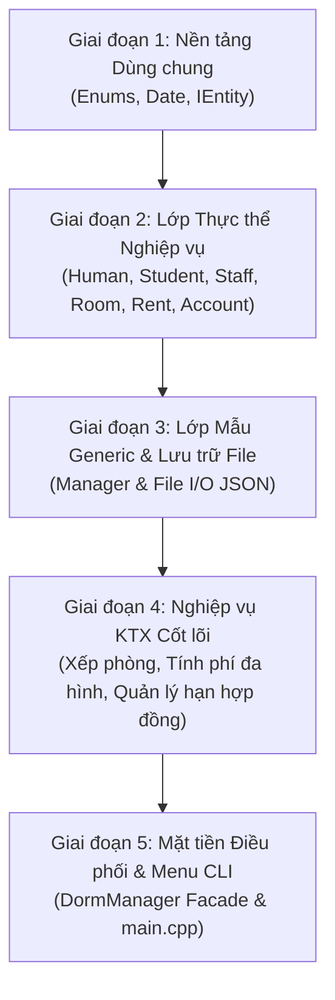

# 🧭 CẨM NANG HƯỚNG DẪN ĐỌC HIỂU & TỰ CODE LẠI DỰ ÁN TỪ ĐẦU
> **Hệ thống Quản lý Ký túc xá Sinh viên (KTX-Management-System) - Đồ án cơ sở PBL2**  
> *Dành cho sinh viên: Lê Viết Huy & Huỳnh Tiến Đạt*

---

## 🎯 Giới thiệu Mục đích Tài liệu
Tài liệu này được thiết kế như một **lộ trình từng bước (Step-by-step Roadmap)** giúp bạn:
1. Nắm bắt được **thứ tự phụ thuộc (Dependency Order)** của các file: biết đọc file nào trước, file nào sau.
2. Có thể **tự tay gõ lại từ đầu (From scratch)** toàn bộ dự án mà không bị rối hay gặp lỗi biên dịch.
3. Hiểu sâu bản chất các nguyên lý **Lập trình hướng đối tượng (OOP)** và các **Mẫu thiết kế (Design Patterns)** được ứng dụng để tự tin đạt điểm tối đa khi phản biện đồ án PBL2.

---

## 🗺️ Bức tranh Tổng thể: Lộ trình 5 Giai đoạn



---

## 🟢 GIAI ĐOẠN 1: NỀN TẢNG DÙNG CHUNG (FOUNDATION LAYER)
*Lớp này hoàn toàn độc lập, không phụ thuộc vào bất kỳ thực thể nào trong hệ thống.*

### 1. Thứ tự đọc & viết code:
1. **`include/common/Enums.h`**:
   * Định nghĩa các kiểu liệt kê: `Gender`, `Role`, `RoomStatus`, `RentStatus`, `Period`.
   * Cài đặt namespace `EnumHelper` với các hàm chuyển đổi chuỗi hai chiều (ví dụ: `roleToString()`, `stringToRole()`).
2. **`include/common/Date.h` & `src/common/Date.cpp`**:
   * Xây dựng lớp xử lý thời gian độc lập: kiểm tra ngày hợp lệ `isValid()`, tính năm nhuận.
   * Nạp chồng toán tử so sánh thứ tự thời gian: `<`, `<=`, `>`, `==`.
   * Cài đặt các hàm toán học ngày tháng quan trọng:
     * `addMonths(m)`: Cộng tháng để tính ngày hết hạn hợp đồng.
     * `toDays()`: Quy đổi ngày sang số nguyên tuyệt đối tính từ năm 1900.
     * `daysBetween(other)`: Tính chính xác khoảng cách số ngày giữa hai mốc thời gian.
3. **`include/common/IEntity.h`**:
   * Khai báo Interface thuần ảo đại diện cho mọi thực thể: `getId() = 0`, `print() = 0`, `toJson() = 0`.
   * Cài đặt hàm `serialize()` (gọi `toJson().dump(2)`).

### 2. Kiến thức OOP & C++ áp dụng:
* **Tính Trừu tượng (Abstraction):** Interface `IEntity` không có thuộc tính, chỉ chứa hàm thuần ảo định nghĩa bộ khung chuẩn.
* **Toán tử nạp chồng (Operator Overloading):** Giúp so sánh 2 đối tượng `Date` tự nhiên như so sánh số nguyên.

### 3. Kịch bản Test mini Giai đoạn 1:
```cpp
// Viết trong main.cpp tạm thời để kiểm tra
Date d1(1, 9, 2026);
Date d2 = d1.addMonths(6); // Kỳ hạn 6 tháng -> 01/03/2027
std::cout << "Ngay het han: " << d2.toString() << "\n";
std::cout << "Khoang cach ngay: " << d1.daysBetween(d2) << " ngay\n";
```

---

## 🟡 GIAI ĐOẠN 2: LỚP THỰC THỂ DỮ LIỆU (DOMAIN MODELS)
*Mô hình hóa các đối tượng đời thực trong Ký túc xá thành các lớp C++ kế thừa từ `IEntity`.*

### 1. Thứ tự đọc & viết code:
1. **Nhánh Con người:**
   * `Human.h/cpp` (Lớp cơ sở trừu tượng kế thừa `IEntity`): Chứa các thuộc tính chung (`fullName`, `phone`, `email`, `address`), hàm ảo `getId() = 0`.
   * `Student.h/cpp` (Kế thừa `Human`): Bổ sung `studentId`, `className`, `faculty`, `cohort` và con trỏ `Rent* rentInfo`.
   * `Staff.h/cpp` (Kế thừa `Human`): Bổ sung `employeeId`, `department`, `position`.
2. **Nhánh Phòng ở (Trọng tâm Đa hình):**
   * `Room.h/cpp` (Lớp cơ sở trừu tượng kế thừa `IEntity`): Quản lý `roomId`, `maxStudents`, `status`, danh sách con trỏ `vector<Rent*> activeRent`, và hàm thuần ảo `calculateTotalFee() = 0`.
   * `StandardRoom.h/cpp` (Kế thừa `Room`): Cài đặt phòng tiêu chuẩn 8 chỗ, ghi đè hàm tính tiền:
     $$\text{Tiền phòng} = 400.000 + (\text{Điện} \times 3.000) + (\text{Nước} \times 10.000)$$
   * `VipRoom.h/cpp` (Kế thừa `Room`): Cài đặt phòng VIP 4 chỗ, có phí dịch vụ 250k, ghi đè hàm tính tiền:
     $$\text{Tiền phòng} = 1.200.000 + 250.000 + (\text{Điện} \times 3.000) + (\text{Nước} \times 10.000)$$
3. **Nhánh Hợp đồng & Bảo mật:**
   * `Rent.h/cpp`: Thực thể liên kết giữa `Student*` và `Room*`, lưu ngày bắt đầu, thời hạn thuê, tính ngày kết thúc dự kiến và thanh lý sớm.
   * `Account.h/cpp`: Tài khoản người dùng, phân quyền theo `Role` (`STUDENT`, `STAFF`, `ADMIN`), thuật toán băm mật khẩu DJB2 sang chuỗi Hex.

### 2. Điểm sáng kiến trúc cần lưu ý:
* **Giải quyết Phụ thuộc vòng (Circular Dependency):** `Student` không trỏ trực tiếp đến `Room`, `Room` không chứa trực tiếp `vector<Student*>`. Cả hai liên kết lỏng lẻo thông qua thực thể trung gian là **`Rent`**.
* **Đóng gói & Serialization:** Mọi lớp đều có cặp hàm `toJson()` và `fromJson()`. Sử dụng hàm `j.value("key", defaultValue)` để chống văng lỗi (crash) khi file JSON bị thiếu trường dữ liệu.

---

## 🟠 GIAI ĐOẠN 3: LỚP MẪU GENERIC & LƯU TRỮ TỆP (REPOSITORY LAYER)
*Tách biệt hoàn toàn việc lưu trữ danh sách dữ liệu ra khỏi các lớp nghiệp vụ.*

### 1. Thứ tự đọc & viết code:
1. **`include/manager/Manager.h` (Template Base Class):**
   * Sử dụng `template <typename T>` với danh sách con trỏ `std::vector<T*> list`.
   * Cài đặt toàn bộ nội dung hàm trong file `.h` (do cơ chế biên dịch Template Instantiation của C++).
   * Cài đặt hàm hủy ảo `virtual ~Manager()` gọi `clear()` để tự động `delete *it`, ngăn chặn triệt để **Rò rỉ bộ nhớ (Memory Leak)**.
   * Cài đặt các hàm CRUD: `add()`, `remove()`, `findById()`, `printAll()`.
2. **Các Manager đơn giản:**
   * `StudentManager.h/cpp` (Kế thừa `Manager<Student>`): Bổ sung lọc theo lớp, khoa.
   * `StaffManager.h/cpp` (Kế thừa `Manager<Staff>`): Bổ sung lọc theo phòng ban.
   * `AccountManager.h/cpp` (Kế thừa `Manager<Account>`): Cài đặt hàm xác thực `authenticate(user, pass)`.
3. **Các Manager phức tạp:**
   * `RoomManager.h/cpp` (Kế thừa `Manager<Room>`): Nạp dữ liệu đa hình từ file JSON (phân biệt tạo `new StandardRoom` hay `new VipRoom`).
   * `RentManager.h/cpp` (Kế thừa `Manager<Rent>`): Hàm `loadFromFile(sm, rm)` để kết nối lại các con trỏ quan hệ giữa sinh viên và phòng tương ứng.

### 2. Cơ chế Đọc/Ghi file:
* Dùng `std::ifstream file(path)` để đọc dữ liệu từ ổ cứng lên RAM.
* Dùng `std::ofstream file(path)` để ghi dữ liệu từ RAM xuống ổ cứng.

---

## 🔵 GIAI ĐOẠN 4: NGHIỆP VỤ KÝ TÚC XÁ CỐT LÕI (BUSINESS LOGIC)
*Xây dựng các quy trình nghiệp vụ thực tế của KTX, bảo vệ tính toàn vẹn dữ liệu.*

### 1. Các logic nghiệp vụ chính:
1. **Quy trình Xếp phòng an toàn (`RentManager::createRent`):**
   * Kiểm tra 3 điều kiện: Sinh viên đã có phòng chưa? Phòng có bị đầy (`room->isFull()`) không? Phòng có đang bảo trì không?
   * Khi thỏa mãn: Khởi tạo hợp đồng mới $\rightarrow$ Thêm vào phòng (`room->addRent()`) $\rightarrow$ Tự động chuyển trạng thái phòng sang `OCCUPIED` hoặc `FULL`.
2. **Quy trình Trả phòng / Thanh lý hợp đồng (`RentManager::terminateRent`):**
   * Đổi trạng thái hợp đồng thành `TERMINATED`, ghi nhận ngày trả thực tế.
   * Gỡ hợp đồng khỏi phòng (`room->removeRent()`) $\rightarrow$ Tự động hoàn trả trạng thái phòng về `OCCUPIED` hoặc `EMPTY`.
3. **Tính phí & Xuất hóa đơn Đa hình (`RoomManager::printRoomBill`):**
   * Gọi hàm ảo `calculateTotalFee(elec, water)` qua con trỏ `Room*` (kích hoạt đúng bảng ảo vtable của phòng thường hoặc VIP).
   * Lấy chi phí điện nước chia đều cho số lượng người đang thực tế ở trong phòng (`activeRent.size()`).
4. **Giám sát vòng đời hợp đồng (`RentManager`):**
   * `findExpiringRents(date, 30)`: Lọc các hợp đồng sắp hết hạn trong 30 ngày.
   * `checkAndExpireRents(date)`: Tự động quét và chuyển trạng thái các hợp đồng quá hạn sang `EXPIRED`, tự động giải phóng phòng.
   * `calculateTotalMonthlyRevenue()`: Tính tổng doanh thu tiền phòng hàng tháng.

---

## 🟣 GIAI ĐOẠN 5: ĐIỀU PHỐI MẶT TIỀN & GIAO DIỆN CONSOLE (FACADE & CLI)
*Đóng gói toàn bộ dự án lại sau một lớp duy nhất và cung cấp giao diện tương tác người dùng.*

### 1. Thứ tự đọc & viết code:
1. **`include/manager/DormManager.h` & `src/manager/DormManager.cpp`:**
   * Áp dụng **Facade Pattern**: Chứa 5 con trỏ đại diện cho 5 Manager bên dưới.
   * Quản lý phiên đăng nhập hiện tại bằng con trỏ `Account* currentAccount`.
   * Cung cấp các hàm công khai: `login()`, `logout()`, `runMainMenu()`.
   * Xây dựng 3 phân hệ Menu tương tác theo quyền hạn:
     * `runAdminMenu()`: Quản lý tài khoản, cán bộ, xem báo cáo tổng thể.
     * `runStaffMenu()`: Quản lý phòng, sinh viên, xếp chỗ, hóa đơn điện nước.
     * `runStudentMenu()`: Xem hồ sơ, bạn cùng phòng, xem hóa đơn tháng, đổi mật khẩu.
   * **Xử lý luồng nhập an toàn:** Cắt bỏ ký tự `\r` và mã UTF-8 BOM (`0xEF, 0xBB, 0xBF`) trong hàm `inputString()` để chống lỗi trôi lệnh khi nhập dữ liệu trên Windows Console.
2. **`main.cpp` (Điểm khởi chạy):**
   * Rút gọn chỉ còn khởi tạo `DormManager app; app.runMainMenu(); return 0;`.

---

## ⚠️ CÁC CẠM BẪY KỸ THUẬT KINH ĐIỂN CẦN NHỚ

| Hiện tượng lỗi | Nguyên nhân | Cách giải quyết trong đồ án |
| :--- | :--- | :--- |
| **Lỗi Linker `undefined reference`** | Tách phần thân hàm của Template `Manager<T>` sang file `.cpp`. | Bắt buộc viết toàn bộ nội dung hàm template trong file header `Manager.h`. |
| **Phụ thuộc vòng (Circular Dependency)** | `Student.h` include `Room.h`, `Room.h` include ngược lại `Student.h`. | Dùng thực thể trung gian `Rent` và dùng **Khai báo chuyển tiếp (Forward Declaration)** `class Rent;`. |
| **Rò rỉ bộ nhớ (Memory Leak)** | Khi xóa phần tử khỏi `vector<T*>` chỉ gọi `erase()` mà không `delete`. | Luôn thực hiện 2 bước: `delete *it;` rồi mới `list.erase(it);`. |
| **Sập chương trình khi đọc JSON** | Đọc khóa không tồn tại bằng cú pháp `j["key"]`. | Luôn dùng hàm phòng thủ `j.value("key", defaultValue)`. |
| **Lỗi trôi lệnh nhập chuỗi trên Windows** | Ký tự xuống dòng `\r\n` hoặc mã UTF-8 BOM sót lại trong bộ đệm `cin`. | Chuẩn hóa hàm nhập `inputString()` sử dụng `std::getline` và xóa sạch `\r` cùng BOM. |

---

## 🎓 BỘ CÂU HỎI VẤN ĐÁP THƯỜNG GẶP KHI BẢO VỆ PBL2

1. **Thầy/Cô hỏi:** *"Em hãy chỉ ra 4 trụ cột OOP nằm ở đâu trong đồ án của nhóm?"*
   * **Trả lời:**
     * *Tính Trừu tượng:* Interface `IEntity` và các lớp cơ sở thuần ảo `Human`, `Room`.
     * *Tính Kế thừa:* `Student`/`Staff` kế thừa `Human`; `StandardRoom`/`VipRoom` kế thừa `Room`; các Manager con kế thừa `Manager<T>`.
     * *Tính Đa hình:* Con trỏ `Room*` gọi hàm ảo `calculateTotalFee(elec, water)` tự kích hoạt tính toán riêng biệt tại thời điểm chạy nhờ bảng ảo vtable.
     * *Tính Đóng gói:* Dữ liệu đều để `private`/`protected`, chỉ truy xuất qua Getter/Setter và các phương thức nghiệp vụ hợp lệ.

2. **Thầy/Cô hỏi:** *"Tại sao em lại sử dụng con trỏ trong `vector<T*>` mà không lưu đối tượng trực tiếp `vector<T>`?"*
   * **Trả lời:**
     * Lưu con trỏ `Room*` cho phép thể hiện **Tính đa hình (Polymorphism)**, chứa được cả `StandardRoom` và `VipRoom` trong cùng một danh sách mà không bị hiện tượng cắt gọt đối tượng (Object Slicing).
     * Tránh sao chép dữ liệu nặng nề khi thêm/xóa phần tử, dễ dàng chia sẻ cùng một đối tượng `Student` hoặc `Room` cho nhiều hợp đồng `Rent` cùng trỏ tới.

3. **Thầy/Cô hỏi:** *"Mẫu thiết kế Facade Pattern trong dự án hoạt động như thế nào?"*
   * **Trả lời:**
     * Lớp `DormManager` đóng vai trò là "mặt tiền" (Facade), tập hợp 5 hệ thống quản lý phức tạp bên dưới (`StudentManager`, `RoomManager`, `RentManager`, `StaffManager`, `AccountManager`).
     * `main.cpp` và người dùng chỉ cần tương tác qua `DormManager` mà không cần quan tâm chi tiết phức tạp của từng Manager bên dưới.
