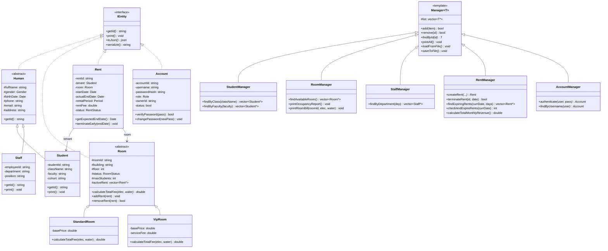

# 🏢 KTX-Management-System (Hệ thống Quản lý Ký túc xá)

> **Đồ án cơ sở: Lập trình hướng đối tượng (OOP) & Cấu trúc dữ liệu - PBL2**  
> Dự án phần mềm quản lý ký túc xá sinh viên được xây dựng hoàn toàn bằng ngôn ngữ **C++ (chuẩn C++17)**, áp dụng chặt chẽ 4 trụ cột của lập trình hướng đối tượng, kiến trúc Repository Pattern và các nguyên lý thiết kế phần mềm sạch.

---

## 👥 1. Thành viên thực hiện

* **Huỳnh Tiến Đạt**
* **Lê Viết Huy**

---

## 🎯 2. Giới thiệu Đề tài & Bài toán thực tế

Quản lý ký túc xá tại các trường đại học thường đối mặt với các thách thức:
* Số lượng sinh viên đăng ký lớn, cần theo dõi chính xác hồ sơ cá nhân, lớp sinh hoạt, khoa viện.
* Phân loại phòng đa dạng (Phòng Tiêu chuẩn vs Phòng VIP) với các chính sách giá, tiện nghi và sức chứa khác nhau.
* Quản lý hợp đồng thuê phòng minh bạch, tránh chồng chéo (phá vỡ phụ thuộc vòng), tính toán tiền phòng kết hợp chỉ số điện nước linh hoạt.
* Hệ thống tài khoản phân quyền chặt chẽ (`STUDENT`, `STAFF`, `ADMIN`) để bảo mật thông tin và phân định tác vụ.
* Dữ liệu phải được lưu trữ lâu dài (Persistence) xuống file JSON chuẩn mực.

Dự án này giải quyết triệt để các bài toán trên bằng cách mô hình hóa các thực thể đời thực vào hệ thống hướng đối tượng chuẩn mực.

---

## 🏛️ 3. Kiến trúc Hướng đối tượng (OOP Architecture)

Dự án thể hiện trọn vẹn 4 trụ cột của lập trình hướng đối tượng:



### 🌟 4 Trụ cột OOP trong đồ án

1. **Tính Trừu tượng (Abstraction):**
   * Interface `IEntity`: Quy định chuẩn chung cho mọi thực thể quản lý (`getId()`, `print()`, `toJson()`, `serialize()`).
   * Lớp cơ sở trừu tượng `Human` và `Room` chứa các phương thức thuần ảo (`= 0`), làm khung sườn vững chắc cho các lớp con.
   * Template `Manager<T>` trừu tượng hóa toàn bộ thao tác quản lý dữ liệu (Repository Pattern).
2. **Tính Kế thừa (Inheritance):**
   * Nhánh con người: `Human` $\rightarrow$ `Student` (Sinh viên) & `Staff` (Cán bộ).
   * Nhánh phòng ở: `Room` $\rightarrow$ `StandardRoom` (Phòng thường) & `VipRoom` (Phòng VIP tiện nghi cao).
   * Nhánh quản lý: `Manager<T>` $\rightarrow$ `StudentManager`, `RoomManager`, `StaffManager`, `RentManager`, `AccountManager`.
3. **Tính Đa hình (Polymorphism):**
   * Quản lý danh sách phòng thông qua con trỏ lớp cơ sở `std::vector<Room*>`.
   * Tại thời điểm thực thi (Runtime), phương thức `calculateTotalFee(electric, water)` tự động kích hoạt logic riêng biệt của từng loại phòng (**Dynamic Binding** qua bảng ảo vtable).
   * Sử dụng hàm hủy ảo `virtual ~Room() = default;` và `virtual ~IEntity() = default;` để giải phóng bộ nhớ triệt để, ngăn ngừa **Memory Leak**.
4. **Tính Đóng gói (Encapsulation):**
   * Toàn bộ thuộc tính dữ liệu đều được bảo vệ trong phạm vi `private` hoặc `protected`.
   * Trạng thái phòng (số người ở, trạng thái `EMPTY`, `OCCUPIED`, `FULL`) chỉ được thay đổi thông qua các phương thức nghiệp vụ hợp lệ (`addRent()`, `removeRent()`).
   * Mật khẩu tài khoản được băm (Hash) an toàn, chỉ truy xuất qua phương thức xác thực `verifyPassword()`.

---

## 📁 4. Cấu trúc Thư mục Dự án

```text
KTX-Management-System/
├── include/                     # Header files (.h)
│   ├── common/                  # Thư viện tiện ích và dùng chung
│   │   ├── Date.h               # Lớp Date xử lý thời gian, so sánh và tính khoảng cách ngày
│   │   ├── Enums.h              # Định nghĩa các Enum (Role, Gender, RoomStatus, RentStatus,...)
│   │   └── IEntity.h            # Interface cơ sở cho mọi Entity
│   ├── model/                   # Các lớp thực thể (Business Models)
│   │   ├── Human.h              # Lớp cơ sở trừu tượng con người
│   │   ├── Student.h            # Lớp Sinh viên
│   │   ├── Staff.h              # Lớp Cán bộ
│   │   ├── Room.h               # Lớp cơ sở trừu tượng phòng
│   │   ├── StandardRoom.h       # Phòng Tiêu chuẩn (8 chỗ)
│   │   ├── VipRoom.h            # Phòng VIP (4 chỗ, điều hòa, dịch vụ cao cấp)
│   │   ├── Rent.h               # Hợp đồng thuê phòng
│   │   └── Account.h            # Tài khoản người dùng & bảo mật
│   ├── manager/                 # Các lớp quản lý dữ liệu & nghiệp vụ (Manager Layer)
│   │   ├── Manager.h            # Lớp khuôn mẫu generic Manager<T> (Repository Template)
│   │   ├── StudentManager.h     # Quản lý Sinh viên
│   │   ├── RoomManager.h        # Quản lý Phòng & Tính toán lấp đầy, hóa đơn điện nước
│   │   ├── StaffManager.h       # Quản lý Cán bộ
│   │   ├── RentManager.h        # Quản lý Hợp đồng, giám sát hạn, doanh thu
│   │   ├── AccountManager.h     # Quản lý Tài khoản & Xác thực người dùng
│   │   └── DormManager.h        # Điều phối trung tâm hệ thống KTX (Facade Pattern)
│   └── nlohmann/
│       └── json.hpp             # Thư viện JSON chuẩn cho C++
├── src/                         # Source files (.cpp)
│   ├── common/
│   │   └── Date.cpp
│   ├── model/
│   │   ├── Human.cpp
│   │   ├── Student.cpp
│   │   ├── Staff.cpp
│   │   ├── Room.cpp
│   │   ├── StandardRoom.cpp
│   │   ├── VipRoom.cpp
│   │   ├── Rent.cpp
│   │   └── Account.cpp
│   └── manager/
│       ├── StudentManager.cpp
│       ├── RoomManager.cpp
│       ├── StaffManager.cpp
│       ├── RentManager.cpp
│       ├── AccountManager.cpp
│       └── DormManager.cpp
├── data/                        # Thư mục chứa các tệp dữ liệu JSON
│   ├── students.json            # Dữ liệu sinh viên
│   ├── rooms.json               # Dữ liệu phòng
│   ├── staffs.json              # Dữ liệu cán bộ
│   ├── rents.json               # Dữ liệu hợp đồng thuê
│   └── accounts.json            # Dữ liệu tài khoản người dùng
├── main.cpp                     # Điểm khởi chạy ứng dụng (Main Entry Point)
├── CHUC_NANG_CAC_HAM.md         # Sổ tay tra cứu chức năng toàn bộ các hàm
├── PBL2.drawio.xml              # Sơ đồ thiết kế kiến trúc chuẩn (draw.io)
├── PBL2.drawio.png              # Hình ảnh sơ đồ quan hệ lớp UML
└── README.md                    # Tài liệu hướng dẫn đồ án
```

---

## 💾 5. Định dạng Lưu trữ Dữ liệu (JSON Storage)

Hệ thống sử dụng thư viện chuẩn **`nlohmann/json`** để lưu trữ và quản lý dữ liệu trong thư mục `data/` dưới dạng các file `.json`:

* **Tài khoản người dùng (`data/accounts.json`):**
  ```json
  [
    {
      "accountId": "ACC001",
      "username": "admin",
      "passwordHash": "admin123",
      "role": "ADMIN",
      "ownerId": "CB001",
      "status": true
    },
    {
      "accountId": "ACC003",
      "username": "an.nv",
      "passwordHash": "123456",
      "role": "STUDENT",
      "ownerId": "SV101",
      "status": true
    }
  ]
  ```
* **Hợp đồng thuê (`data/rents.json`):**
  ```json
  [
    {
      "rentId": "HD002",
      "studentId": "SV102",
      "roomId": "P201",
      "rentalPeriod": 12,
      "startDate": "01/09/2026",
      "actualEndDate": "01/09/2027",
      "rentFee": 1200000.0,
      "status": "ACTIVE"
    }
  ]
  ```

---

## 🚀 6. Hướng dẫn Biên dịch & Chạy ứng dụng

### Yêu cầu môi trường
* Trình biên dịch C++ hỗ trợ **C++17 trở lên** (`g++`, `clang++`, hoặc `MSVC`).
* Hệ điều hành: Windows, macOS hoặc Linux.

### Biên dịch bằng dòng lệnh (Terminal / PowerShell)

Sử dụng lệnh `g++` để biên dịch toàn bộ hệ thống:

```powershell
g++ -std=c++17 -Iinclude src/common/Date.cpp src/model/Human.cpp src/model/Student.cpp src/model/Staff.cpp src/model/Room.cpp src/model/StandardRoom.cpp src/model/VipRoom.cpp src/model/Rent.cpp src/model/Account.cpp src/manager/StudentManager.cpp src/manager/RoomManager.cpp src/manager/StaffManager.cpp src/manager/RentManager.cpp src/manager/AccountManager.cpp src/manager/DormManager.cpp main.cpp -o app.exe
```

### Chạy chương trình
```powershell
.\app.exe
```

### 🔑 Danh sách tài khoản thử nghiệm hệ thống

| Tên đăng nhập | Mật khẩu | Quyền hạn (`Role`) | Chức năng truy cập |
| :--- | :--- | :--- | :--- |
| **`admin`** | `admin123` | **ADMIN** | Toàn quyền quản trị hệ thống, tài khoản, cán bộ, xem báo cáo tổng thể. |
| **`cuong.lv`** | `staff123` | **STAFF** | Bàn làm việc cán bộ: xếp phòng, quản lý sinh viên, xuất hóa đơn điện nước. |
| **`an.nv`** | `123456` | **STUDENT** | Cổng sinh viên: xem hồ sơ cá nhân, xem phòng, xem hóa đơn tháng. |
| **`bich.tt`** | `123456` | **STUDENT** | Sinh viên phòng VIP P201: xem chi phí phòng VIP. |

---

## 🗺️ 7. Kế hoạch phát triển (Project Roadmap)

- [x] **Giai đoạn 1 (Completed):** Phân tích thiết kế hệ thống, cài đặt Interface `IEntity`, `Date`, `Enums` và các lớp thực thể `Student`, `Staff`, `StandardRoom`, `VipRoom`, `Rent`. Chạy thử nghiệm thành công tính đa hình và serialization.
- [x] **Giai đoạn 2 (Completed):** Xây dựng lớp mẫu generic `Manager<T>` (áp dụng C++ Template) và các lớp quản lý con (`StudentManager`, `RoomManager`, `StaffManager`, `RentManager`). Tích hợp đọc/ghi file từ thư mục `data/`.
- [x] **Giai đoạn 3 (Completed):** Xây dựng các nghiệp vụ cốt lõi nâng cao:
  - Cài đặt thực thể `Account` & lớp quản lý `AccountManager` (xác thực đăng nhập, băm mật khẩu, phân quyền theo Role).
  - Giám sát vòng đời hợp đồng: cảnh báo hợp đồng sắp hết hạn (30 ngày), tự động xử lý hợp đồng quá hạn.
  - Báo cáo phân tích tỷ lệ lấp đầy phòng ký túc xá (Occupancy Rate).
  - Tính tiền phòng và phụ phí điện nước đa hình (`calculateTotalFee`), chia đều cho sinh viên trong phòng và xuất phiếu báo chi phí.
  - Thống kê doanh thu tiền phòng hàng tháng.
- [x] **Giai đoạn 4 (Completed):** Xây dựng lớp điều phối trung tâm `DormManager` (**Facade Pattern**) và giao diện dòng lệnh Console Menu tương tác phân quyền (`CLI Dashboard`) độc lập cho 3 vai trò: `ADMIN`, `STAFF`, `STUDENT`. **Hoàn thành 100% đồ án PBL2!**

---

## 📜 8. Bản quyền & Thông tin môn học

Đồ án được thực hiện bởi nhóm sinh viên **Lê Viết Huy** & **Huỳnh Tiến Đạt** nhằm phục vụ cho học phần **Đồ án cơ sở: Lập trình hướng đối tượng (PBL2)**.  
Mã nguồn được phân phối cho mục đích học tập và nghiên cứu.
