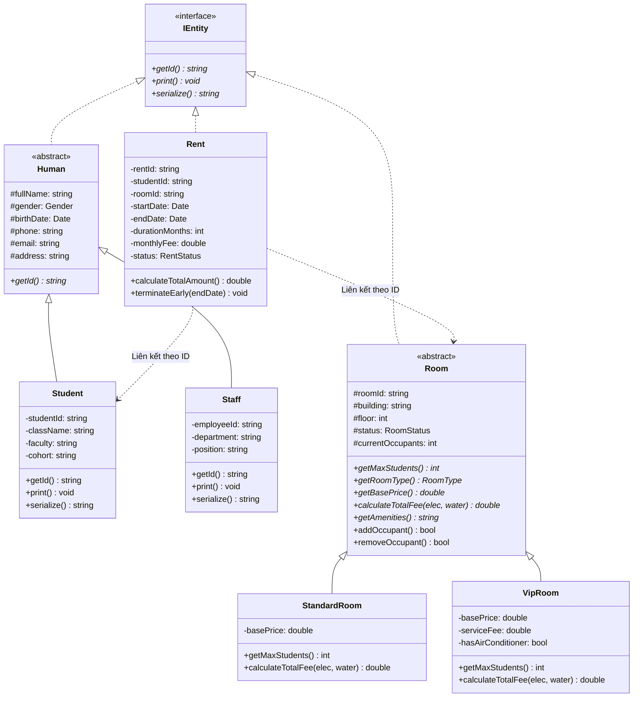

# 🏢 KTX-Management-System (Hệ thống Quản lý Ký túc xá)

> **Đồ án cơ sở: Lập trình hướng đối tượng (OOP) & Cấu trúc dữ liệu - PBL2**  
> Dự án phần mềm quản lý ký túc xá sinh viên được xây dựng hoàn toàn bằng ngôn ngữ **C++ (chuẩn C++17)**, áp dụng chặt chẽ 4 trụ cột của lập trình hướng đối tượng và các nguyên lý thiết kế phần mềm sạch.

---

## 👥 1. Thành viên thực hiện

**Huỳnh Tiến Đạt** , 
 **Lê Viết Huy** 
---

## 🎯 2. Giới thiệu Đề tài & Bài toán thực tế

Quản lý ký túc xá tại các trường đại học thường đối mặt với các thách thức:
* Số lượng sinh viên đăng ký lớn, cần theo dõi chính xác hồ sơ cá nhân, lớp sinh hoạt, khoa phòng.
* Phân loại phòng đa dạng (Phòng Tiêu chuẩn vs Phòng VIP) với các chính sách giá, tiện nghi và sức chứa khác nhau.
* Quản lý hợp đồng thuê phòng minh bạch, tránh chồng chéo (con trỏ hai chiều gây lỗi đồng bộ), tính toán tiền phòng kết hợp chỉ số điện nước linh hoạt.
* Dữ liệu phải được lưu trữ lâu dài (Persistence) xuống file để không bị mất khi đóng chương trình.

Dự án này giải quyết triệt để các bài toán trên bằng cách mô hình hóa các thực thể đời thực vào hệ thống hướng đối tượng chuẩn mực.

---

## 🏛️ 3. Kiến trúc Hướng đối tượng (OOP Architecture)

Dự án thể hiện trọn vẹn 4 trụ cột của lập trình hướng đối tượng:



### 🌟 4 Trụ cột OOP trong đồ án

1. **Tính Trừu tượng (Abstraction):**
   * Interface `IEntity`: Quy định chuẩn chung cho mọi thực thể quản lý (`getId()`, `print()`, `serialize()`).
   * Lớp trừu tượng `Human` và `Room` chứa các phương thức thuần ảo (`= 0`), đóng vai trò làm khung sườn vững chắc cho các lớp con.
2. **Tính Kế thừa (Inheritance):**
   * Nhánh con người: `Human` $\rightarrow$ `Student` (Sinh viên) & `Staff` (Cán bộ quản lý).
   * Nhánh phòng ở: `Room` $\rightarrow$ `StandardRoom` (Phòng thường) & `VipRoom` (Phòng VIP tiện nghi cao).
3. **Tính Đa hình (Polymorphism):**
   * Quản lý danh sách phòng thông qua con trỏ lớp cơ sở: `std::vector<Room*>`.
   * Tại thời điểm thực thi (Runtime), phương thức `calculateTotalFee()` và `getMaxStudents()` sẽ tự động kích hoạt logic riêng biệt của từng loại phòng (**Dynamic Binding** qua bảng ảo vtable).
   * Sử dụng hàm hủy ảo `virtual ~Room() = default;` và `virtual ~IEntity() = default;` để giải phóng bộ nhớ triệt để, ngăn ngừa **Memory Leak**.
4. **Tính Đóng gói (Encapsulation):**
   * Toàn bộ thuộc tính dữ liệu đều được bảo vệ trong phạm vi `private` hoặc `protected`.
   * Trạng thái phòng (số người ở, trạng thái ĐẦY/CÒN TRỐNG) chỉ được thay đổi thông qua các phương thức nghiệp vụ hợp lệ (`addOccupant()`, `removeOccupant()`).

### 🛡️ Điểm sáng thiết kế: Giải quyết Phụ thuộc vòng (Circular Dependency)
Thay vì để `Student` giữ con trỏ `Room*` và `Room` giữ `vector<Student*>` gây nguy cơ con trỏ lạc (dangling pointer) và khó đồng bộ dữ liệu, đồ án sử dụng **`Rent` (Hợp đồng thuê phòng)** làm thực thể trung gian liên kết:
* `Rent` lưu trữ `studentId` và `roomId`.
* Giữ được toàn bộ lịch sử thuê phòng của sinh viên, hỗ trợ gia hạn, chấm dứt hợp đồng sớm và tính tiền minh bạch.

---

## 📁 4. Cấu trúc Thư mục Dự án

```text
KTX-Management-System/
├── include/                     # Header files (.h)
│   ├── common/                  # Thư viện tiện ích và dùng chung
│   │   ├── Date.h               # Lớp Date xử lý thời gian, so sánh ngày tháng
│   │   ├── Enums.h              # Định nghĩa các kiểu liệt kê (Role, Gender, RoomStatus,...)
│   │   └── IEntity.h            # Interface cơ sở cho các Entity
│   └── model/                   # Các lớp thực thể (Business Models)
│       ├── Human.h              # Lớp cơ sở trừu tượng con người
│       ├── Student.h            # Lớp Sinh viên
│       ├── Staff.h              # Lớp Cán bộ
│       ├── Room.h               # Lớp cơ sở trừu tượng phòng
│       ├── StandardRoom.h       # Phòng Tiêu chuẩn (8 chỗ)
│       ├── VipRoom.h            # Phòng VIP (4 chỗ, điều hòa, dịch vụ cao cấp)
│       └── Rent.h               # Hợp đồng thuê phòng
├── src/                         # Source files (.cpp)
│   ├── common/
│   │   └── Date.cpp             # Cài đặt Date
│   └── model/
│       ├── Human.cpp            # Cài đặt Human
│       ├── Student.cpp          # Cài đặt Student
│       ├── Staff.cpp            # Cài đặt Staff
│       ├── Room.cpp             # Cài đặt Room
│       ├── StandardRoom.cpp     # Cài đặt StandardRoom
│       ├── VipRoom.cpp          # Cài đặt VipRoom
│       └── Rent.cpp             # Cài đặt Rent
├── data/                        # Thư mục chứa các file dữ liệu (.txt / .dat)
├── main.cpp                     # Điểm khởi chạy chương trình & kiểm thử hệ thống
├── PBL2.drawio.png              # Sơ đồ quan hệ lớp UML
└── README.md                    # Tài liệu hướng dẫn đồ án
```

---

## 💾 5. Định dạng Lưu trữ Dữ liệu (Serialization)

Hệ thống sử dụng cơ chế định dạng chuỗi phân cách bởi ký tự gạch đứng (`|`), đảm bảo dễ đọc, dễ chỉnh sửa và mở rộng:

* **Sinh viên (`Student`):**
  ```text
  SV101|Nguyen Van An|Nam|15/03/2004|0901234567|an.nv@sv.dut.udn.vn|Da Nang|22T_DT1|Cong nghe Thong tin|K22
  ```
* **Phòng Tiêu chuẩn (`StandardRoom`):**
  ```text
  STANDARD|P101|Khu A|1|Dang o|1|400000
  ```
* **Phòng VIP (`VipRoom`):**
  ```text
  VIP|P201|Khu VIP|2|Dang o|1|1200000|250000|1
  ```
* **Hợp đồng thuê (`Rent`):**
  ```text
  HD001|SV101|P101|01/09/2026|01/07/2027|10|400000|Hieu luc
  ```

---

## 🚀 6. Hướng dẫn Biên dịch & Chạy ứng dụng

### Yêu cầu môi trường
* Trình biên dịch C++ hỗ trợ **C++17 trở lên** (`g++`, `clang++`, hoặc `MSVC`).
* Hệ điều hành: Windows, macOS hoặc Linux.

### Biên dịch bằng dòng lệnh (Terminal / PowerShell)

Sử dụng lệnh `g++` để biên dịch toàn bộ mã nguồn:

```powershell
g++ -std=c++17 -Iinclude src/common/Date.cpp src/model/Human.cpp src/model/Student.cpp src/model/Staff.cpp src/model/Room.cpp src/model/StandardRoom.cpp src/model/VipRoom.cpp src/model/Rent.cpp main.cpp -o app.exe
```

### Chạy chương trình
```powershell
.\app.exe
```

---

## 🗺️ 7. Kế hoạch phát triển (Project Roadmap)

- [x] **Giai đoạn 1 (Completed):** Phân tích thiết kế hệ thống, cài đặt Interface `IEntity`, `Date`, `Enums` và các lớp thực thể `Student`, `Staff`, `StandardRoom`, `VipRoom`, `Rent`. Chạy thử nghiệm thành công tính đa hình và serialization.
- [ ] **Giai đoạn 2:** Xây dựng lớp mẫu generic `Manager<T>` (áp dụng C++ Template) và các lớp quản lý con (`StudentManager`, `RoomManager`, `RentManager`). Tích hợp đọc/ghi file từ thư mục `data/`.
- [ ] **Giai đoạn 3:** Xây dựng các nghiệp vụ cốt lõi nâng cao (xếp sinh viên vào phòng, xuất hóa đơn điện nước tháng, lọc phòng trống theo tiêu chí, thống kê doanh thu).
- [ ] **Giai đoạn 4:** Xây dựng hệ thống tài khoản (`Account`), xác thực đăng nhập (`AuthService`) và giao diện dòng lệnh phân quyền menu tương tác (`MenuUI`).

---

## 📜 8. Bản quyền & Thông tin môn học

Đồ án được thực hiện bởi nhóm sinh viên **Lê Viết Huy** & **Huỳnh Tiến Đạt** nhằm phục vụ cho học phần **Đồ án cơ sở: Lập trình hướng đối tượng (PBL2)**.
Mã nguồn được phân phối cho mục đích học tập và nghiên cứu.